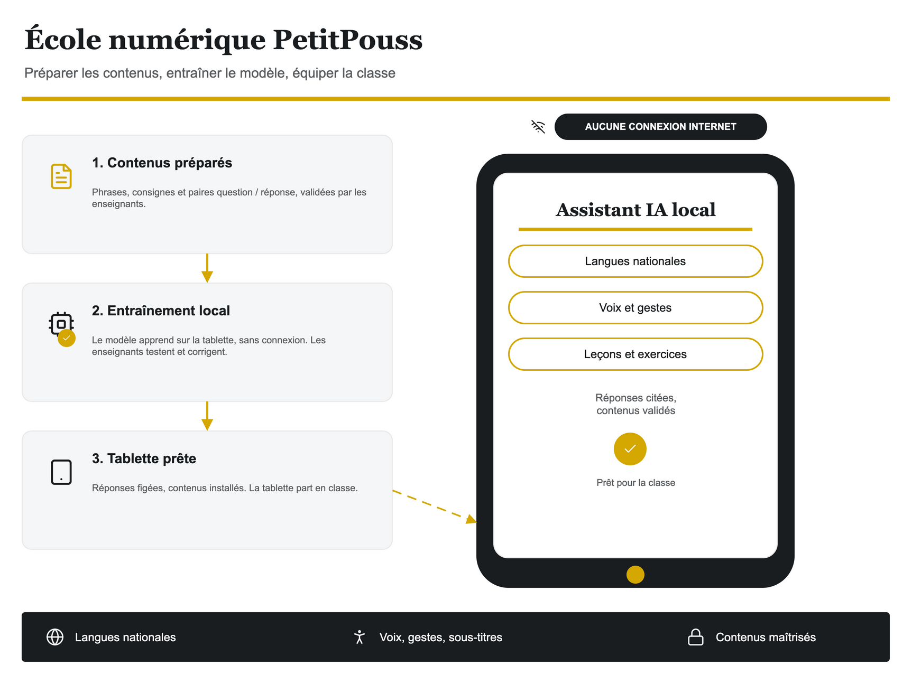

# Exemple PetitPouss — planche pédagogique

Générateur minimal qui applique la charte PetitPouss : trois étapes à gauche,
la tablette à droite, un bandeau de synthèse. Il sert de point de départ pour
une note, un dossier bailleur ou une fiche de formation.



```bash
# 1. Générer le .drawio
python3 examples/petitpouss/demo-education.py

# 2. Contrôler la structure (doit finir sur 0 erreur, 0 avertissement)
python3 skills/drawio-skill/scripts/validate.py examples/petitpouss/demo-education.drawio --score

# 3. Exporter un aperçu PNG
/Applications/draw.io.app/Contents/MacOS/draw.io \
  --export --format png --scale 2 --border 20 \
  -o /tmp/demo-education.png examples/petitpouss/demo-education.drawio
```

`ppicons.py` a besoin de PyMuPDF pour rasteriser les pictogrammes :

```bash
python3 -m pip install pymupdf
# ou, si le python système est protégé (PEP 668)
python3 -m venv /tmp/ppicons && /tmp/ppicons/bin/pip install pymupdf
```

## Adapter

Tout tient dans trois blocs du script :

| Bloc | Ce qu'on change |
| --- | --- |
| `STEPS` | les trois titres et leurs descriptions |
| coordonnées de `tablet-*` | les compétences affichées sur la tablette |
| `band-*` | la synthèse du bas, trois éléments maximum |

Les cartes sont des conteneurs : leurs textes et leur pictogramme sont des
enfants (`parent="c1"`), donc ils suivent la carte dans draw.io. Pour ajouter
une étape, copier une entrée de `STEPS` et décaler `y` de 140.

La charte, les tailles et les pièges sont décrits dans
`skills/drawio-skill/references/petitpouss.md`.
